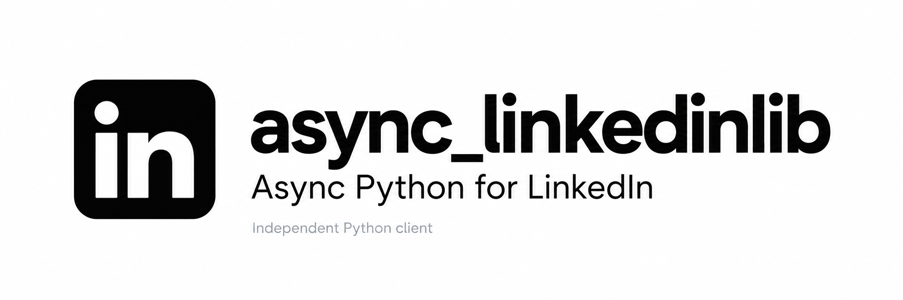

<p align="center">
  
</p>

# async_linkedinlib

[](https://github.com/Anandesh-Sharma/async_linkedinlib/actions/workflows/ci.yml)
[](https://pypi.org/project/async_linkedinlib/)

[](https://github.com/Anandesh-Sharma/async_linkedinlib/blob/main/LICENSE)


Async Python client for LinkedIn's private Android API (app 4.1.1267). One saved session
drives everything: sign-in, the feed, your posts, comments, search and jobs with Easy Apply.
Connections and messages are not built yet. Python 3.11+ is required.

## At a glance

| Area | What you can do |
| --- | --- |
| Sessions | Import your own cookies, persist sessions and verify your account |
| Feed | Home, profile and company feeds, reactions, saves and polls |
| Publishing | Posts, media uploads, comments and replies |
| Search | People, companies, content, jobs and other supported search categories |
| Jobs | Search, details, saved jobs and explicit Easy Apply steps |

Connections and messages are not implemented. Google sign-in exchanges a caller-supplied
fresh token; it does not acquire one. See [feature status](#feature-status) for the
boundary between offline tests and previously recorded live verification.

[Sessions](#saved-sessions) · [Feed](#feed-linkedinfeed) · [Posts](#posts-linkedinposts) ·
[Search](#search-linkedinsearch) · [Jobs](#jobs-and-easy-apply-linkedinjobs) ·
[Feature status](#feature-status) · [Development](#development)

One account, one async client, one shared connection pool. Pagination and writes
are explicit; session files preserve account state between runs.

This is an independent, unofficial client for LinkedIn's private API. It is not
affiliated with or endorsed by LinkedIn. Private endpoints can change without notice.
Saved-session ownership uses POSIX file locks; use macOS or Linux.

## Install

Requires Python 3.11 or newer. Install from PyPI:

```sh
pip install async_linkedinlib
```

For development and the `uv run` examples below:

```sh
git clone https://github.com/Anandesh-Sharma/async_linkedinlib.git
cd async_linkedinlib
uv sync --locked
```

For reproducible deployments, pin a PyPI version or install a reviewed Git commit: `git+https://github.com/Anandesh-Sharma/async_linkedinlib.git@<commit-sha>`.

## Saved sessions

`li_at` is the primary session credential. The client also keeps `JSESSIONID` and
sends its unquoted value as `csrf-token`. Import your own cookie pair through hidden
prompts, verify it with LinkedIn, and save it outside the repository:

```sh
uv run async-linkedinlib import-session \
  --session ~/.local/share/async_linkedinlib/account.session.json
uv run async-linkedinlib me \
  --session ~/.local/share/async_linkedinlib/account.session.json
```

```python
import asyncio
from pathlib import Path
from async_linkedinlib import LinkedIn

async def main():
    path = Path.home() / ".local/share/async_linkedinlib/account.session.json"
    async with LinkedIn.from_session_file(path) as linkedin:
        me = await linkedin.account.me()
        print(me.full_name, me.id)

asyncio.run(main())
```

For credentials obtained through your own secure input, use
`Session.from_cookies(li_at, jsessionid)` with `LinkedIn(session)`. The explicit
constructor uses in-memory state; call `session.save(path)` when persistence is
needed. `Session.load(path)` restores state without checking server validity.
`session.authenticated` only checks local credential presence and expiration.
`account.me()` checks server acceptance and returns a `Member`.

Session files are written atomically with mode 0600. Cookies retain domain, path,
secure flag and expiry. Device identity and app profile persist with them.
The file-backed client checkpoints cookie changes and saves on close without
logging out. It owns a POSIX sidecar lock until closed; a second owner raises
`SessionInUse`. Do not remove the lock file while another process may own it.
One file per account; share its active client among tasks.

## Google sign-in

```sh
uv run async-linkedinlib login-google \
  --session ~/.local/share/async_linkedinlib/google.session.json
```

The hidden prompt expects a **fresh Google ID token issued for LinkedIn's Android
sign-in flow**. An arbitrary token issued for your own Google OAuth client is not
equivalent. The SDK does not sign into Google, obtain that token, or replay the
recorded token. In Python, call `await linkedin.auth.login_google(id_token)` on a
client without an existing authenticated session.

The captured sequence is:

1. `GET /mob/tracking` obtains fresh server cookies. The app uses a generated
   `JSESSIONID` in `ajax:<19 digits>` form; the client generates a fresh value when
   the bootstrap does not supply one.
2. `POST /uas/authenticate` submits a URL-encoded Google token with the recorded
   `soogleLoginRequestType=ONE_TAP_AUTO_LOGIN` spelling, native captcha capability,
   CSRF cookie and fresh bootstrap cookies.
3. A `login_result=PASS` response sets `li_at` and rotates `JSESSIONID`.
4. `GET /mob/sso/you` verifies the session and reads the member identity.

The login method returns the verified `Member`. It neither stores the Google token
nor retries the exchange. A challenge URL is available through
`ChallengeRequired.challenge_url` but is not followed or included in its message.
Complete challenges in the official app. Email/password login, Google token
acquisition, MFA continuation and remote logout are not implemented.

## How requests are made

The app draws feed, post, comment, search and job screens with server-driven protobuf. The
same APK still ships the classic Voyager operations, and Voyager answers plain JSON on the
same session, so every feature calls those: persisted GraphQL queries and mutations
(`/voyager/api/graphql`) and rest.li routes (`/voyager/api/<route>`), with variables encoded
exactly as the app encodes them ([transport/voyager.py](https://github.com/Anandesh-Sharma/async_linkedinlib/blob/main/src/async_linkedinlib/transport/voyager.py),
[transport/restli.py](https://github.com/Anandesh-Sharma/async_linkedinlib/blob/main/src/async_linkedinlib/transport/restli.py)). Query IDs, variable names,
enums and bodies come from the app's code; each was then checked against the live service.

Every resource shares the client's one session and connection pool. Lists return a
`Page` with `items`, `total` (when LinkedIn gives one) and `next`, a `Cursor` that continues
only the operation, query and session that made it; pass it back as `cursor=`. Paging
follows the app's pager (next start = `paging.start + paging.count`, until `paging.total`
or an empty page), and nothing fetches the next page by itself. `count` and `cursor` are
keyword arguments everywhere. Writes are sent once and never retried. URNs and IDs are
strings. Every public type is importable from `async_linkedinlib`. Models keep the provider
object in `raw` (left out of repr).

```python
from async_linkedinlib import FeedSort, LinkedIn, ReactionType

async with LinkedIn.from_session_file(path) as linkedin:
    page = await linkedin.feed.home(count=10, sort=FeedSort.RECENT)
    post = page.items[0]
    await linkedin.feed.react(post.urn, ReactionType.CELEBRATE)
    comments = await linkedin.comments.list(post.urn)
    more = await linkedin.feed.home(count=10, sort=FeedSort.RECENT, cursor=page.next)
```

### Feed (`linkedin.feed`)

| Operation | Method |
| --- | --- |
| Main feed, top or recent | `home(count, sort, cursor)` |
| One post by activity, ugcPost or share URN | `get(urn)` |
| A member's posts, or posts they commented on or reacted to | `profile(profile_urn, activity, count, cursor)` |
| A company page's posts (all, images, videos, documents, articles) | `company(company_urn, content, count, cursor)` |
| Who reacted, by type and order | `reactions(urn, reaction, sort, count, cursor)` |
| React, change, remove | `react(urn, reaction)`, `change_reaction`, `unreact` |
| Save, unsave, saved posts | `save(activity_urn)`, `unsave`, `saved(count, cursor)` |
| Hide a post and undo | `hide(post.update_urn)`, `undo_hide` |
| Vote on a poll and withdraw | `vote(option.urn)`, `unvote` |

`Post.urn` is the post's social thread (reactions and comments use it); `activity_urn` is the
feed activity, which differs for "X likes this" updates. Recommendation modules are not posts,
so `items` can be shorter than `count` (`page.raw` keeps them). `save` takes the post's own
activity URN. Profile feeds give no total. No read shows whether a post is hidden.

### Posts (`linkedin.posts`)

```python
from async_linkedinlib import CommentScope, Image, MediaKind, Mention, Visibility

text = "Hello from Ada Lovelace"
shared = await linkedin.posts.create(
    text, visibility=Visibility.CONNECTIONS_ONLY, comments=CommentScope.ANYONE,
    mentions=[Mention("urn:li:fsd_profile:<id>", text.index("Ada"), 12)],
)
photo = await linkedin.posts.media.upload("photo.png", MediaKind.IMAGE)
await linkedin.posts.create("With a photo", media=Image(photo))
await linkedin.posts.edit(shared.share_urn, "Hello again")
await linkedin.posts.delete(shared.share_urn)
```

| Operation | Method | Verified |
| --- | --- | --- |
| Text post with visibility, comment control, member/company mentions | `create` | live |
| Schedule, list, reschedule, cancel | `create(publish_at=)`, `scheduled`, `reschedule`, `cancel_scheduled` | live |
| Edit text and mentions; delete | `edit`, `delete` | live |
| Who may comment on a published post | `set_comment_scope` | live |
| Instant repost and undo | `repost`, `undo_repost` | live |
| Upload image, video, document; processing status; link preview | `media.upload`, `media.status`, `media.link_preview` | live |
| Image, gallery, video, document, poll and link posts; repost with thoughts | `create(media=...)`, `repost_with_thoughts` | offline (see limits) |

Mention offsets count Unicode code points; the server silently drops a wrong offset.
Hashtags are plain `#text`. After publishing only text and mentions can be edited. A gallery
needs `session.member_id` (call `account.me()` once). Galleries and polls are created before
the post and remain if the post is refused. Uploads must come back as single-request
uploads. Uploaded media cannot be deleted. Unverified accounts get a small daily posting
limit, raised as `OperationRejected`; the test account hit it before the media post kinds
could be published, so those shapes are tested offline only.

### Comments (`linkedin.comments`)

| Operation | Method |
| --- | --- |
| Top-level comments, relevant or recent, with reply previews | `list(post_urn, sort, count, cursor)` |
| Replies, oldest first; one comment | `replies(comment_urn, count, cursor)`, `get(comment_urn)` |
| Comment, reply (with member mentions) | `create(post_urn, text, mentions)`, `reply(comment_urn, text, mentions)` |
| Edit, delete own comment | `edit(comment_urn, text, mentions)`, `delete(comment_urn)` |
| React, change, remove; who reacted (`Reactor`s, as for posts) | `react`, `change_reaction`, `unreact`, `reactions(comment_urn, reaction, sort, count, cursor)` |
| Hide another member's comment on your post | `hide(comment)`, `unhide(comment)` (offline only) |

Comment URNs may be `urn:li:comment:(activity:<post>,<id>)` or
`urn:li:fsd_comment:(<id>,urn:li:activity:<post>)`. A reply to a reply attaches to its
top-level comment. Text only: no image, GIF or company mentions; no pinning.

### Search (`linkedin.search`)

```python
from async_linkedinlib import JobFilters, PeopleFilters, TypeaheadKind

berlin = (await linkedin.search.typeahead(TypeaheadKind.GEO, "Berlin", count=1))[0]
people = await linkedin.search.people("python developer", PeopleFilters(locations=[berlin.id]))
jobs = await linkedin.search.jobs("python", JobFilters(location=berlin.id, easy_apply=True))
job = await linkedin.jobs.get(jobs.items[0].id)
```

| Operation | Returns |
| --- | --- |
| `all(keywords)` | `Page[ResultGroup]`: People, Posts, Jobs, Companies blocks |
| `people`, `services` (with `PeopleFilters`, `ServiceFilters`) | `Page[PersonResult]` |
| `posts` (with `PostFilters`) | `Page[Post]` |
| `companies`, `groups`, `schools`, `events`, `courses`, `products` | `Page[SearchResult]` |
| `jobs` (with `JobFilters`) | `Page[JobResult]`; `id` goes to `linkedin.jobs` |
| `filters(vertical, keywords)`, `job_filters(keywords)` | available filters and suggested values |
| `typeahead(kind, text)`, `suggest(text)` | `Suggestion`s; `id` is the filter value |

Filters are typed dataclasses per vertical; ID fields take IDs or simple URNs, and `extra`
passes any other key that `filters()` lists. People filters cover connection degree,
locations, current and past companies, schools, industries, profile languages, connections
of, followers of, service categories, open to volunteering and name/title/company/school
keywords. Job filters cover location and distance, date posted, Easy Apply, under 10
applicants, in my network, verified, workplace, experience, job type, company, place,
salary, industry, function, title and commitments; `workplace` takes the same
`WorkplaceType` that `Job` reports. Searches never add to search history.
People, company, group and service results stop at 1,000; `total` is an estimate.

### Jobs and Easy Apply (`linkedin.jobs`)

```python
from pathlib import Path

form = await linkedin.jobs.application(job.id)       # pages, questions, offered resumes
for question in form.questions:
    print(question.label, question.kind, [o.label for o in question.options])
resume = await linkedin.jobs.upload_file(
    Path("resume.pdf"), max_size=form.file("Resume").max_size     # refuse before storing
)
submission = linkedin.jobs.submission(
    form, {"Mobile phone number": "5550100"}, files={"Resume": resume}, job=job
)
for label, values in submission.answers:            # checked locally; nothing sent yet
    print(label, values)
status = await linkedin.jobs.submit(submission)      # applies; sent once
```

| Operation | Method | Verified |
| --- | --- | --- |
| Job details (title, company, place, workplace, type, description, applicants, Easy Apply, state) | `get(job)` | live |
| Save, unsave; My jobs lists (saved, in progress, applied, archived) | `save`, `unsave`, `tracked(status, count, cursor)` | live |
| Easy Apply form with typed questions and file slots | `application(job)` | live |
| Store a .pdf/.doc/.docx file | `upload_file(file)` | live |
| Check answers and build the app's submission | `submission(form, answers, files)` | live, not sent |
| Send the application | `submit(submission)` | offline only |

Answers are checked against question kinds, options and limits; unanswered questions keep
LinkedIn's prefill. Date, location and typeahead questions keep their prefill, conditional
rules are not evaluated, and forms that need a data-consent step or have repeatable sections
are refused. Following the company is off unless `follow_company=True`. Uploaded files cannot
be deleted, and the app has no withdraw. `submit` has not been sent to the live service:
the one real application is left to the account owner.

## Failures and transport

Expected failures inherit from `LinkedInError`. Authentication rejection, required
verification, HTTP failures, network failures, rate limits, unexpected protocol responses
and refused operations have separate exception classes. `OperationRejected.reasons` holds
LinkedIn's GraphQL messages (for example a validation error or the daily posting limit);
`HTTPError.reason` holds rest.li's one-line client-error message when there is one.
`UnconfirmedWrite` (a `ProtocolError`) means LinkedIn accepted a write but its reply could
not be read: the change may exist, so read the state back before sending it again.
Errors do not attach raw HTTP responses or include credentials in messages. A 403 is conservatively reported as requiring
review in the app; it does not prove which verification or restriction occurred.

HTTP 401 clears the local `li_at` credential. HTTP 429 records the `Retry-After`
cooldown and blocks further requests locally until it expires. Without a valid
server hint, the local fallback is 60 seconds. Cooldowns persist with the session.
No network operation is automatically retried, and redirects are not followed.
Requests are serialized per client so cookie rotation is applied in order.

`ClientOptions(timeout=30, max_connections=1)` configures the HTTPX pool.
TLS verification stays enabled and ambient proxy environment variables are ignored.
The SDK contacts only `https://www.linkedin.com` (media and resume uploads go to its
`/dms-uploads/` and `/ambry/` paths); it needs neither an emulator nor the capture proxy at
runtime. The low-level HTTPX transport can be injected
for tests. Do not enable HTTP wire logging when using real credentials.

## Files and verification

```text
src/async_linkedinlib/
  client.py                 public client, lifecycle and resource construction
  cli.py                    interactive login, import-session and me commands
  exceptions.py             public, credential-safe failures
  auth/service.py           Google login orchestration and fresh bootstrap
  config/                   connection options, versioned Android app metadata
  session/                  identity, scoped cookies, cooldowns, atomic persistence, lease
  transport/
    http.py                 shared HTTPX pool, headers, cookie rotation and errors
    voyager.py              GraphQL queries/mutations and rest.li calls, error decoding
    restli.py               the app's rest.li variable encoding
  resources/
    account.py              current-member read and verification
    paging.py               the app's pager: collections, pages and session-bound cursors
    threads.py              post and comment thread URNs, social-detail URNs
    mentions.py             member/company mentions in post and comment text
    reactions.py            react, change, remove and list reactions on posts and comments
    feed/                   home, single post, profile/company feeds, saves, hides, polls
    posts/                  create, edit, delete, schedule, repost; media uploads
    comments/               list, replies, create, reply, edit, delete, reactions
    search/                 verticals, job search, filters, typeahead
    jobs/                   job details, saved jobs, tracker, Easy Apply
  models/                   typed results and inputs per feature; content.py holds Post,
                            Author and ReactionType; pagination.py holds Page and Cursor
tests/                      one folder per area, synthetic data, httpx.MockTransport;
                            restli_decode.py reads what a test request sent
examples/                   account, feed, posts, comments, search, jobs
AGENTS.md                   library architecture and contribution rules
```

The call path is `LinkedIn resource → Voyager → Transport → LinkedIn HTTP endpoint`.
All resources use the client's one session and transport. Models contain data;
resources own feature behavior; the client assembles them and manages lifetime.
See [AGENTS.md](https://github.com/Anandesh-Sharma/async_linkedinlib/blob/main/AGENTS.md) before adding functionality.

### Feature status

| Client group | Status |
| --- | --- |
| `auth` | Google-token exchange; tested locally, fresh exchange not live-verified |
| `account` | live verified |
| `feed`, `comments`, `search` | live verified, except comment hide/unhide (offline) |
| `posts` | live verified, except posts with media, polls, links and repost with thoughts (offline; daily posting limit) |
| `jobs` | live verified up to Easy Apply submit; `submit` offline only |
| `connections`, `messages` | not built |

```sh
uv run pytest -q
uv run ruff check src tests examples
uv run ruff format --check src tests examples
uv run mypy src
uv build
```

Evidence comes from a private Android research lab (not distributed here): the
`login-20261031-055813` capture for sign-in; recordings of every feature flow in the app;
and the decompiled 4.1.1267 APK, whose Voyager GraphQL clients, routes and request builders
give each operation's query ID, variables and body. Each module names its query IDs.
The login capture contains a successful Google exchange and account verification and no password login. Raw captures,
Google tokens and real account cookies remain outside this package. The four
unavailable response-body exports were streaming/unrelated records; the login and
account-verification bodies were exported successfully.

Postman CLI 1.45.0 lacks the simulation command required by the installed skill.
Verification uses synthetic protocol tests and a real loopback HTTP server instead.

Verified on 2026-10-31:

- The official Android app completed Google sign-in and returned `li_at` and
  `JSESSIONID` in the captured success response.
- A fresh Python bootstrap to `/mob/tracking` returned HTTP 200 and server cookies.
- The SDK imported only the captured `li_at`/`JSESSIONID` credential pair and called
  `account.me()` successfully; the member matched the captured account response.
- Reopening the saved session and reading the account again succeeded without login.
- Synthetic protocol and real loopback HTTP tests cover the Google exchange, cookie
  rotation/deletion, session persistence, malformed responses, challenge reporting,
  rejected sessions, redirects, network failures and persisted rate limits.

Feature verification on 2026-10-31 used the test account through the SDK itself: each
operation in the tables above marked live was run once, every write was undone or deleted,
and the cleanup was confirmed with a read. Five test media uploads, one gallery container,
one poll container and one Easy Apply resume file remain stored on LinkedIn because the app
offers no way to delete them; none is attached to a post, profile or application.

A fresh programmatic Google ID-token exchange has not been live-verified. The
captured token was not replayed.

## Development

The normal suite uses synthetic data and local HTTP servers. It does not need a
LinkedIn account. Run these checks before opening a pull request:

```sh
uv sync --locked
uv run pytest -q
uv run ruff check src tests examples
uv run ruff format --check src tests examples
uv run mypy src
uv build
```

CI runs these checks on Linux and macOS with Python 3.11 and 3.13. Historical live
verification is documented above; CI does not verify current private API behavior.

Keep changes focused, include a synthetic regression test for behavior changes,
and update this README when a public method changes. Open a
[bug report or feature request](https://github.com/Anandesh-Sharma/async_linkedinlib/issues/new/choose) with a minimal example,
Python/package versions, and a redacted error. Keep cookies, passwords, tokens,
session files, raw captures and real account data out of issues and pull requests.

## Related library

[async_instalib](https://github.com/Anandesh-Sharma/async_instalib) is the companion async Python client for Instagram. Each package is independent.

## License

[MIT](https://github.com/Anandesh-Sharma/async_linkedinlib/blob/main/LICENSE) © 2026 Anandesh Sharma.

## Releases

Publishing a GitHub release runs the complete CI matrix, builds a wheel and source
archive, validates package metadata, and uploads both to PyPI with
[trusted publishing](https://docs.pypi.org/trusted-publishers/). No stored PyPI token
is needed. The publisher is bound to `Anandesh-Sharma/async_linkedinlib`, `release.yml`, and
the GitHub environment `pypi`.

1. Update `project.version` in `pyproject.toml`, run `uv lock`, and commit to `main`.
2. Publish a GitHub release with the matching tag `v<version>` from that commit.
3. Check the [publishing workflow](https://github.com/Anandesh-Sharma/async_linkedinlib/actions/workflows/release.yml) and
   [PyPI project](https://pypi.org/project/async_linkedinlib/).

Tags must match the package version exactly and point to a commit on `main`.
A draft release does not publish. A published prerelease does; use a matching
PEP 440 prerelease version such as `0.3.0rc1`. Re-running a release skips files
already present only after checking their SHA-256 hashes match the build.
